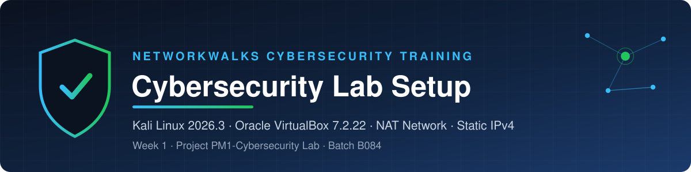

# 


# 🛡️ NetworkWalks-B084-WK1-CyberSecurity-Lab-Setup

📅 **Week 1** • 📂 **PM1 Cybersecurity Lab** • 🏷️ **Batch B084** • 🎓 **NetworkWalks Academy • CyberSecurity Training**

   

---

# · Overview and Setup

## 🚀 Overview

The goal of Week 1 is to build a virtual cybersecurity lab using Oracle VirtualBox and Kali Linux to support ethical hacking, penetration testing, network configuration, and daily cybersecurity practice.

The lab provides a controlled environment where security tools can be explored, network connectivity tested, and practical exercises performed safely without affecting production systems.

Week 1 builds the foundation of the lab: **Kali Linux 2026.3** on **Oracle VirtualBox 7.2.22**, a private **NAT Network**, a **static IPv4 address**, verified connectivity and a **snapshot** to restore from.

## 🌐 Lab Topology

```text
💻 Windows 11 Host
        │
        ▼
📦 VirtualBox 7.2.22
        │
        ▼
🌐 NAT Network (10.0.0.0/24)
        │
        ▼
🐉 Kali Linux 2026.3
   IP: X.X.X.X
        │
        ▼
🚪 Gateway / DNS
   10.0.0.1
        │
        ▼
☁️ Internet
```

## 🎯 Purpose of the Lab

A safe, isolated and repeatable environment for learning cybersecurity by doing, without putting real systems at risk.

|  | Purpose | How the lab delivers it |
| --- | --- | --- |
| 🛡️ | **Safe practice** | Everything runs in a private NAT Network on virtual machines |
| 🌐 | **Networking fundamentals** | Static IPv4, routing, gateway and DNS configured and verified by hand |
| 🐉 | **Hands-on Kali Linux** | A real security workstation for Linux administration and tooling |
| 🔁 | **Repeatable baseline** | Snapshots let you roll back after any experiment |
| 🚀 | **Foundation for later work** | Ready for reconnaissance, vulnerability assessment and ethical hacking exercises |

## 🧩 Lab more details 

|  |  |
| --- | --- |
| 💻 **Host** | Windows 11 · VirtualBox 7.2.22 |
| 🐉 **Guest** | Kali Linux 2026.3 (`kali-linux-2026.3-virtualbox-amd64`) |
| 🌐 **Network** | NAT Network `NatNetwork` · `10.0.0.0/24` · DHCP server enabled |
| 📍 **Kali IP** | `X.X.X.X/24` on `eth0` · method **Manual** · profile `LabTest` |
| 🚪 **Gateway / DNS** | `10.0.0.1` |

## 📋 Requirements

|  | Requirement | Used for |
| --- | --- | --- |
| ✅ | **Windows 11 host** | Runs VirtualBox and the lab VM |
| ✅ | **7-Zip / WinRAR** | Extracting the Kali VM archive |
| ✅ | **Oracle VirtualBox 7.2.22** | Hypervisor for the lab |
| ✅ | **VirtualBox Extension Pack** | Extra VirtualBox features; must match the VirtualBox version |
| ✅ | **Kali Linux 2026.3** VirtualBox image | The security workstation VM |

> \[Be Alert\] Hardware virtualization (Intel VT-x / AMD-V) must be enabled in BIOS/UEFI to run a 64-bit guest.
